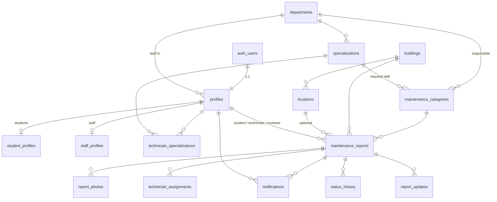
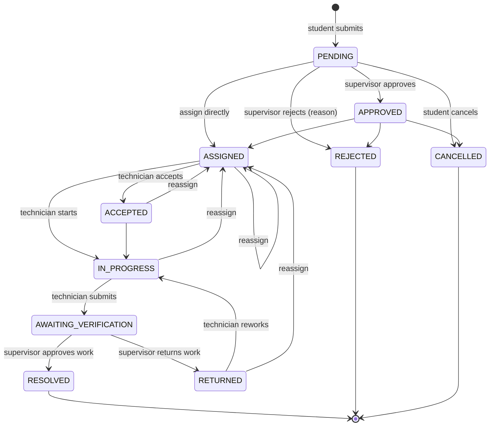

# Database architecture

Source of truth: [`supabase/schema.sql`](../supabase/schema.sql). Reference data: [`supabase/seed.sql`](../supabase/seed.sql).

## Entity overview

## Tables

| Table                        | Purpose                                  | Key columns                                                                                                                                                                                                           |
| ---------------------------- | ---------------------------------------- | --------------------------------------------------------------------------------------------------------------------------------------------------------------------------------------------------------------------- |
| `profiles`                   | One row per auth user                    | `role` (`STUDENT/SUPERVISOR/TECHNICIAN/ADMIN`), `department_id`, `is_active`                                                                                                                                          |
| `student_profiles`           | Student details                          | `matric_number` (unique), `programme`, `level`, `building_id`, `room_number`                                                                                                                                          |
| `staff_profiles`             | Staff details                            | `staff_number`, `job_title`, `is_available`                                                                                                                                                                           |
| `departments`                | Maintenance departments                  | `name`, `code`, `is_active`                                                                                                                                                                                           |
| `specializations`            | Technician skills                        | `name`, `department_id`                                                                                                                                                                                               |
| `technician_specializations` | Technician ↔ specialization              | composite PK                                                                                                                                                                                                          |
| `buildings`                  | Campus buildings                         | `type` (`ACADEMIC/HOSTEL/ADMINISTRATIVE/SPORTS/OTHER`)                                                                                                                                                                |
| `locations`                  | Rooms/facilities/areas inside a building | `building_id`, `type`, `floor`                                                                                                                                                                                        |
| `maintenance_categories`     | Complaint categories                     | `department_id` (routing), `specialization_id` (technician matching)                                                                                                                                                  |
| `maintenance_reports`        | Complaints                               | `reference_number` (`CMR-YYYY-NNNNN`), `status`, `priority`, `student_id`, `current_technician_id`, `reviewed_by`, `rejection_reason`, `completion_notes`, `started_at`, `completed_at`, `verified_by`, `resolved_at` |
| `report_photos`              | Photo metadata                           | `stage` (`REPORT`/`COMPLETION`), `storage_path`                                                                                                                                                                       |
| `technician_assignments`     | Assignment history                       | `status` (`ACTIVE/REASSIGNED/COMPLETED`), `instructions`, `assigned_at`, `accepted_at`, `ended_at`                                                                                                                    |
| `status_history`             | Audit trail of every status change       | `from_status`, `to_status`, `changed_by`, `note`                                                                                                                                                                      |
| `report_updates`             | Comments/progress/feedback               | `type` (`COMMENT/PROGRESS/REVIEW/FEEDBACK/RESOLUTION/ASSIGNMENT`), `is_internal`                                                                                                                                      |
| `notifications`              | Per-user notifications                   | `type`, `title`, `message`, `report_id`, `is_read`, `read_at`                                                                                                                                                         |
| `activity_log`               | Administrative audit log                 | `actor_id`, `action`, `entity_type`, `details`                                                                                                                                                                        |

## Report status state machine

Enforced in `public._is_valid_transition()`; mirrored for the UI in `packages/shared` (`VALID_TRANSITIONS`).

## Notifications (trigger `notify_on_status_change` on `status_history`)

| Event                                               | Recipient                                                                              |
| --------------------------------------------------- | -------------------------------------------------------------------------------------- |
| Submitted (→ PENDING)                               | Student (confirmation) + supervisors of the category's department (or all supervisors) |
| Approved / Rejected                                 | Student (with rejection reason)                                                        |
| Assigned / Reassigned                               | Technician; student on first assignment                                                |
| Work started (→ IN_PROGRESS from ASSIGNED/ACCEPTED) | Student                                                                                |
| Submitted for verification                          | Student + reviewing supervisor (or department supervisors)                             |
| Returned                                            | Technician (with feedback)                                                             |
| Resolved                                            | Student                                                                                |
| Cancelled                                           | Assigned technician                                                                    |

## Row Level Security summary

| Data                                                     | Who can read                                                                                 | Who can write                           |
| -------------------------------------------------------- | -------------------------------------------------------------------------------------------- | --------------------------------------- |
| Reference tables                                         | Everyone (registration form needs buildings)                                                 | Admins                                  |
| `profiles`                                               | Self; staff see all; students see staff                                                      | RPC only                                |
| `student_profiles`                                       | Self, staff                                                                                  | RPC only                                |
| `maintenance_reports`, `report_photos`, `status_history` | `can_view_report()`: supervisors/admins, owning student, current or past assigned technician | RPC only                                |
| `report_updates`                                         | As above, `is_internal` rows hidden from students                                            | RPC only                                |
| `technician_assignments`                                 | Technician, supervisors/admins, report viewers                                               | RPC only                                |
| `notifications`                                          | Owner                                                                                        | Owner may delete; read state via RPC    |
| `activity_log`                                           | Admins                                                                                       | Triggers/RPC                            |
| Storage `report-photos`                                  | Uploader, or anyone who can view the linked report                                           | Authenticated users into `<uid>/…` only |

All helper functions return no role for deactivated users, so a deactivated account loses all access even with a valid token.
